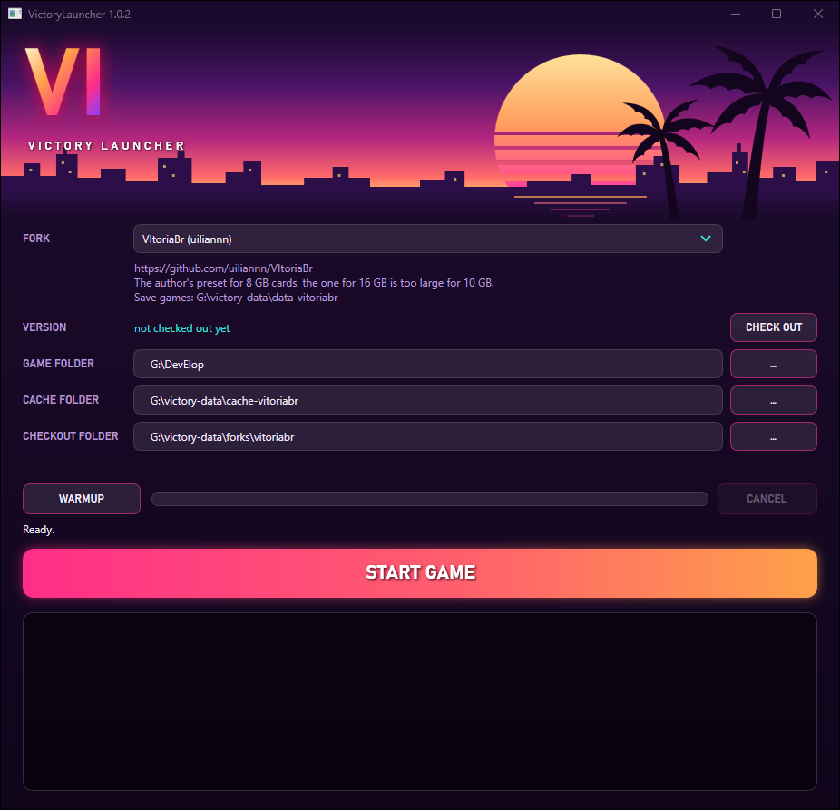

# VictoryLauncher

A Windows launcher for the forks of the VIctory family: pick a fork, check it out, build the release, warm up the
shaders (if the fork can do that) and start the game.

Game files are not included, you need your own, lawfully obtained ones. This project is not affiliated with Rockstar
Games, Take-Two or Microsoft, nor with the authors of the forks.



## Requirements

- Windows x64
- git
- Rust (rustup) with the C++ Build Tools of Visual Studio
- for kelvaroq only: Python 3.11 or newer and the Windows SDK
- to build from source: the .NET 10 SDK, and PowerShell 7 for the tests (the ready made ZIP from the releases needs
  neither)

## Built in forks

| Fork | Warmup | Settings |
|------|--------|----------|
| [AnyXboxX](https://github.com/LooperSalty/AnyXboxX) | yes (`shaders` with every archive and binary of the game, of which the program skips files over 2 GB: a count, from the second time a percentage; then `warm` for the [recorded pipelines](#recorded-pipelines)) | from `crates\anyxboxx\src\run\settings.rs`, they follow the updates |
| [klbf-lab](https://github.com/PastiiJay/klbf-lab) | yes (`translate`), with a percentage | from the README of the fork, without its Series S setup |
| [Vice-Tay](https://github.com/TaynanGT/Vice-Tay) | yes (`shaders`: a count, from the second time a percentage; then `warm` for the [recorded pipelines](#recorded-pipelines)) | from its `play.ps1` (NVIDIA) |
| [VIctory-7900XTX](https://github.com/avatarmanz/VIctory-7900XTX) | yes (`shaders`: a count, from the second time a percentage; then `warm` for the [recorded pipelines](#recorded-pipelines)) | from its `play.ps1`, tuned for AMD |
| [kelvaroq](https://github.com/fablinoo/kelvaroq) | yes (`precompile`): the pipelines of earlier game runs, with a percentage | the tier for 10 GB |
| [VItoriaBr](https://github.com/uiliannn/VItoriaBr) | yes (`warm`), without a percentage | its preset for 8 GB |
| [victory-fork](https://github.com/fxceless/victory-fork) | no | `VICTORY_TEXTURE_BACK=1` |
| [VIctory (DexNom)](https://github.com/DexNom/VIctory) | yes (`warm`), with a percentage | its experimental NVIDIA mode (ray tracing and FSR off), developed for AMD |

The launcher reads the kind of warmup from the help of the built program. There is also
"Own Git URL …" (`https://` only, a layout with `apps\victory` in the root or below `third_party\victory`, no special
settings).

Apart from AnyXboxX, the settings are a snapshot from 2026-11-26, meant for an NVIDIA card with 10 GB, as far as the
fork allows it. The launcher cannot tell whether a fork shows a picture on your PC.

## Recorded pipelines

For AnyXboxX, Vice-Tay and VIctory-7900XTX the launcher adds one setting of its own, `VICTORY_PIPELINE_BOOK=1`. The
forks do not switch it on themselves.

- **Play first:** While the game runs, it writes down every pipeline it creates, in `pipelines\known-pipelines.bin` and
  `pipelines\known-shaders.bin` in the cache folder. The second file holds shaders of the game itself, so do not share
  it. The launcher never copies these files anywhere.
- **Then warm up:** The pipeline step builds everything that was recorded, what the game has drawn with first, and
  skips what the fork has built before. A cancelled warmup goes on where it stopped.
- **Rebuild all pipelines** also builds what was built before. The fork remembers what it built, not whether the
  graphics driver still has it, so use it for example after the shader cache of the driver was cleared. A cancelled
  rebuild starts over.

**It is not shown that this helps.** It was measured once, with AnyXboxX on one PC with an RTX 3080: 3,000 pipelines
that had never been built took 75 seconds, and 2,418 pipelines the game had drawn with took 4 minutes. Building those
a second time took just as long, and no change was seen in the shader cache of the graphics driver. With 83,561
recorded pipelines, building them all takes more than half an hour by that measure. Whether the game stutters less has
not been measured.

## What the launcher does

- **Third party code:** Before it checks out a fork for the first time, it asks once per address (AnyXboxX is
  confirmed in advance). After that, new commits are fetched, built and run without asking again. Building alone
  already runs third party code with your permissions.
- **Staying up to date:** When it opens, before every warmup and before every game start it fetches new commits
  (fast forward only) and builds the release. Your own changes in the checkout are not overwritten.
- **Game folder:** The launcher writes nothing into it.
- **Program check:** Before the game starts, it lists programs that use video memory or CPU. Nothing is ticked in
  advance. Ticked programs are closed normally; whatever keeps running is only force closed after a second question.
- **Warmup progress:** It is read from the lines the fork prints. In the running launcher it has only been tried with
  AnyXboxX (37d4686), at a time when nothing was recorded for its pipeline step. For the other forks it was written from their
  sources, for Vice-Tay also checked against saved logs. If the lines do not match, you see the last line of the output
  instead (kelvaroq reports the warmup as incomplete then).
- **Driver cache:** It does not manage the shader cache of the graphics driver. What the pipeline step of AnyXboxX,
  Vice-Tay and VIctory-7900XTX builds is only kept there.

## Console: Series X or Series S

The list next to **Start game** sets which console the game sees, for each fork on its own. **Series X** is what every
built in fork does by itself and the default; the launcher then starts the game as before. With **Series S** it adds
`--console series-s` to the start of the game. The warmup is not changed.

With Series S the launcher shows below what is known about the fork, taken from its own files on 2026-11-26 (in a
small window the note may only be visible as the tooltip of the list). The authors disagree: some describe it as
lighter and faster, one fork's table shows it slower than Series X with 1080p output, and a tester of another got a
black picture. klbf-lab would need AMD's FidelityFX SDK for it, which the launcher does not pass on to the game. The
game has not been started as a Series S with this launcher.

## Keyboard controls

**CONTROLS** next to **Start game** shows which key stands in for which input of the controller with the chosen fork.
The keys only count while the game window has the focus and no controller is connected.

All built in forks except AnyXboxX use the same keys, by the letter on the key. AnyXboxX goes by the place of a key on
the keyboard, so the launcher names its keys as your keyboard layout has them. On a German keyboard, for example, LT is
the key labelled `Y` with AnyXboxX and the key labelled `Z` with the others.

The tables are written into the launcher (a snapshot from 2026-11-26): a fork that changes its keys is shown wrong
until the launcher follows. For an own Git URL the usual table is shown, not checked for that fork.

## Updates of the launcher

Only the EXE from a release updates itself. A launcher you built yourself shows `(local build)` in the window title and
does not even look for updates.

- When it opens, the launcher asks GitHub in the background for the latest release of this repository (without signing
  in). If it is newer than the launcher itself, a bar with an **Update** button appears. When you are offline or
  something fails, there is at most one line in the log.
- Only a click downloads the ZIP, checks its size and SHA-256, replaces the EXE and restarts the launcher.
  `settings.json` and `logs\` are kept. The button is disabled while the launcher checks, builds or warms up, and while
  the game runs.
- The folder of the EXE has to be writable.
- The EXE is not signed. The checksum comes from the same GitHub account as the ZIP: it detects damaged downloads, but
  it does not protect you if someone takes over the account.

If you have been building the launcher yourself, unpack the ZIP of a release once and copy your `settings.json` next
to it.

## Folders

Defaults:

| What | Where |
|------|-------|
| Game folder | `G:\DevElop` |
| Checkout, cache and save games of a fork | `G:\victory-data\forks\<id>`, `cache-<id>`, `data-<id>` |
| AnyXboxX | checkout `G:\AnyXboxX`, cache `G:\victory-data\cache-anyxboxx`, save games in the default location of the runtime |

You can change the game, cache and checkout folders in the window, and the root `G:\victory-data` as `DataRoot` in
`settings.json`. `settings.json` and `logs\` are next to the EXE. If an existing `settings.json` cannot be read, the
launcher says so, uses the default values and does not overwrite the file.

## Building

```powershell
dotnet test tests/VictoryLauncher.Tests
```

```powershell
dotnet publish src/VictoryLauncher -c Release -o app
```

Some tests open test windows of their own outside the screen or need the performance counters of a graphics card. They
have the category `Desktop` and do not run on the build server (`--filter "Category!=Desktop"`).

## Release

You build a new version on GitHub: **Actions → Release → Run workflow**, branch `main`, with a `version` such as
`1.0.0`. The action checks the number, runs the tests, builds the self-contained ZIP and creates the tag `v1.0.0` with
its release. The number has to consist of three numbers and be higher than all earlier ones. Older launchers then offer
it as an update.

Pushing a tag yourself still works:

```powershell
git tag v1.0.0
```

```powershell
git push origin v1.0.0
```

The release notes list the titles of the commits since the release before that changed something in `src`, so those
titles are written for the people who use the launcher. Commits that only touch docs, tests or the build are left out,
and merge commits too. The notes can still be edited on GitHub afterwards. They come from
[Get-ReleaseNotes.ps1](packaging/Get-ReleaseNotes.ps1), which you can run yourself to see them before a release:

```powershell
./packaging/Get-ReleaseNotes.ps1 -Tag v1.1.0 -Repository Cr1TiKa7/VictoryLauncher
```

Every push to `main` and every pull request also runs the tests and builds a ZIP (version `0.0.0`) that is attached to
the run as an artifact, without creating a release. The rules for the version number are in
[Get-ReleaseVersion.ps1](packaging/Get-ReleaseVersion.ps1). The tests of both scripts need PowerShell 7.
